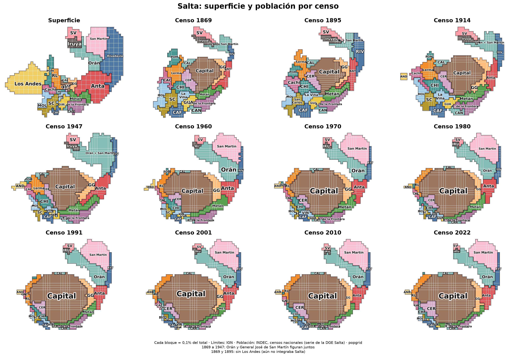
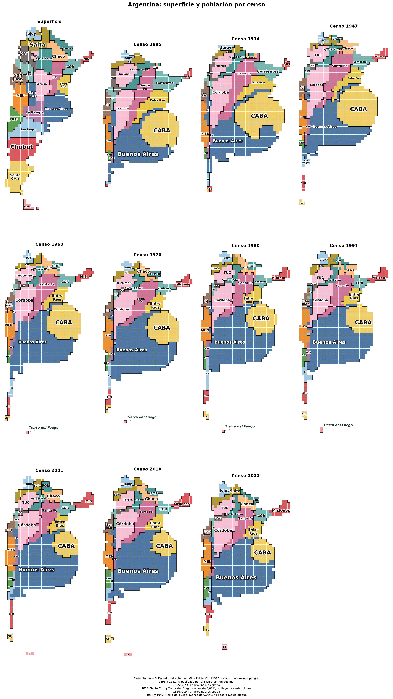

# popgrid-argentina

**Mapas de bloques de Argentina y de Salta: cómo cambió el peso de cada provincia y de cada departamento a lo largo de los censos. Salta por departamento desde 1869; provincias desde 2001.**

Este proyecto usa [popgrid](https://github.com/databites-tech/popgrid) para dibujar *block cartograms*: mapas en los que **cada bloque representa la misma porción del total**. Con 1.000 bloques, cada uno equivale al 0,1% de la superficie o al 0,1% de la población. El mismo territorio, con los mismos colores, se dibuja de dos formas. Donde la tierra y la gente no coinciden aparece la historia.

Dos niveles de análisis:

| Nivel | Censos | Regiones | Pregunta |
|---|---|---|---|
| `provincias` | 2001, 2010, 2022 | 24 jurisdicciones | ¿Qué provincias ganaron o perdieron peso en la población del país? |
| `salta` | los 11 censos nacionales, de 1869 a 2022 | 23 departamentos | ¿Cuánto se concentra Salta en Capital? ¿Qué pasó con el norte (Orán, San Martín) y con los Valles? |

Como el total cambia de un censo a otro, los mapas de distintos años muestran el **peso relativo** de cada región. Un departamento puede haber crecido en habitantes y, aun así, achicarse en el mapa si creció menos que el resto.

<p align="center">
  
</p>

En 1869, Capital tenía el 19% de la población salteña y los Valles Calchaquíes (Cachi, Molinos, San Carlos, La Poma y Cafayate) el 23%. Hoy Capital tiene el 43,5% y los Valles el 2,9%. El norte cuenta otra historia: Orán y San Martín pasaron del 5% en 1869 al 21% en 1947 y al 27% en 1960, con el auge del azúcar y el petróleo, y desde entonces rondan el 24%. En los últimos censos, Cerrillos (del 2,4% en 2001 al 3,9% en 2022) y La Caldera, que más que duplicó sus habitantes, son las zonas que más crecen alrededor de la capital.

Hasta 1947, Orán y San Martín eran un solo departamento, y así se dibujan. Los Andes (la Puna) pasó a Salta recién en 1943, por eso no aparece en 1869 ni en 1895.

<p align="center">
  
</p>

Buenos Aires y CABA suman el 45% del país. La Patagonia, enorme en superficie, ocupa una franja angosta. Neuquén, Santa Cruz y Tierra del Fuego son las que más peso ganaron; CABA y Santa Fe, las que más perdieron.

---

## Instalación

Requiere Python 3.10 o superior. Se recomienda [uv](https://docs.astral.sh/uv/):

```bash
uv sync --extra dev        # crea .venv e instala todo
```

Con pip:

```bash
python3.12 -m venv .venv && source .venv/bin/activate
pip install -e ".[dev]"
```

---

## Uso

### 1. Descargar los límites (una sola vez)

```bash
uv run python scripts/descargar_limites.py
```

Baja la capa de departamentos del [IGN](https://www.ign.gob.ar/) (~140 MB, queda en `data/raw/` y no se sube a git) y genera dos archivos livianos en `data/limites/`:

- `provincias.geojson`: las 24 jurisdicciones, armadas uniendo departamentos. Se excluyen Antártida Argentina e Islas del Atlántico Sur.
- `salta_departamentos.geojson`: los 23 departamentos de Salta.
- `departamentos.geojson`: todos los departamentos del país, para trabajar otras provincias.

### 2. Datos censales (ya incluidos)

La población ya está cargada en:

- [`data/censos/provincias.csv`](data/censos/provincias.csv): 24 jurisdicciones; 2001, 2010 y 2022.
- [`data/censos/departamentos.csv`](data/censos/departamentos.csv): los 528 departamentos, partidos y comunas del país, con su código INDEC; 2001, 2010 y 2022. Salta es el subconjunto que empieza con `66`.
- [`data/censos/salta_historico.csv`](data/censos/salta_historico.csv): los 23 departamentos de Salta en los 11 censos nacionales, de 1869 a 2022. La fila `66126+66056` representa a Orán y San Martín cuando todavía eran un solo departamento (hasta 1947). Es la serie que usa el nivel `salta`, y se regenera con `uv run python scripts/construir_salta_historico.py --forzar`.

Las cifras salen de 48 cuadros oficiales del INDEC (dos por provincia). El detalle está en [`data/censos/FUENTES.md`](data/censos/FUENTES.md). Para regenerarlas desde el INDEC:

```bash
uv run python scripts/construir_censos.py --forzar
```

El script verifica que el valor de 2010 coincida entre las publicaciones de 2010 y 2022, y que en cada provincia los departamentos sumen el total provincial. Solo dos departamentos no tienen dato en algún censo, porque se crearon después: Lezama (Buenos Aires) y Tolhuin (Tierra del Fuego).

```python
from popgrid_ar.censos import cargar_departamentos

cargar_departamentos("66")  # Salta
cargar_departamentos()  # todo el país
```

| Censo | Total del país | Salta | Capital (Salta) |
|---|---|---|---|
| 2001 | 36.260.130 | 1.079.051 | 472.971 (43,8%) |
| 2010 | 40.117.096 | 1.214.441 | 536.113 (44,1%) |
| 2022 | 45.892.285 | 1.441.351 | 627.704 (43,5%) |

### 3. Generar los mapas

```bash
# Superficie + un mapa por censo, lado a lado
uv run python scripts/generar_mapas.py salta --modo comparar

# Un mapa por censo
uv run python scripts/generar_mapas.py provincias --modo poblacion

# Solo superficie (no necesita datos censales)
uv run python scripts/generar_mapas.py salta --modo superficie

# Tabla de participación (%) y variación entre censos, en CSV
uv run python scripts/generar_mapas.py salta --modo tabla

# Todo junto
uv run python scripts/generar_mapas.py salta --modo todo
```

Opciones: `--censos 2010 2022` para elegir años, `--n 2000` para usar más bloques (más detalle para departamentos chicos) y `--out carpeta/`. Todo se guarda en `output/`.

### Desde Python

```python
from popgrid_ar.mapas import comparar_censos, mapa_poblacion
from popgrid_ar.censos import cargar_censo, tabla_participacion

mapa_poblacion("salta", 2022).savefig("salta_2022.png", dpi=170, bbox_inches="tight")
comparar_censos("provincias", [2001, 2022])
tabla_participacion(cargar_censo("salta"))
```

---

## Estructura

```
├── src/popgrid_ar/
│   ├── config.py      # rutas, códigos INDEC, exclusiones, etiquetas cortas
│   ├── limites.py     # descarga del IGN, dissolve a provincias, simplificación
│   ├── censos.py      # lectura, validación y tabla de participación
│   └── mapas.py       # mapas de superficie, población y comparación con popgrid
├── scripts/
│   ├── descargar_limites.py
│   ├── construir_censos.py
│   ├── construir_salta_historico.py
│   └── generar_mapas.py
├── data/
│   ├── censos/        # CSV de población 2001/2010/2022 + FUENTES.md (versionado)
│   ├── limites/       # GeoJSON simplificados (versionado, generado por script)
│   └── raw/           # descargas crudas del IGN y del INDEC (ignorado por git)
├── tests/
└── output/            # mapas generados (ignorado por git)
```

---

## Fuentes

- **Límites:** Instituto Geográfico Nacional (IGN), capa `departamento` del [servicio WFS](https://wms.ign.gob.ar/geoserver/ows). Incluye el código INDEC de cada departamento, que se usa para unir con los censos.
- **Población:** INDEC, Censos Nacionales de Población, Hogares y Viviendas 2001, 2010 y 2022. Para la serie de Salta desde 1869, la [Dirección General de Estadísticas de Salta](https://estadisticas.salta.gov.ar/) (Anuario 2025, cuadro 2.1.1, sobre la base de los censos nacionales del INDEC). El detalle de cada cuadro está en [`data/censos/FUENTES.md`](data/censos/FUENTES.md).

## Créditos

Los mapas los dibuja [popgrid](https://github.com/databites-tech/popgrid), de [Josep Ferrer](https://databites.tech) ([databites.tech](https://databites.tech)), con licencia MIT. Este proyecto solo lo usa como dependencia y no modifica su código. Al publicar un mapa, conviene incluir una línea como *Hecho con popgrid de databites.tech*.

## Licencia

MIT. Ver [LICENSE](LICENSE).
