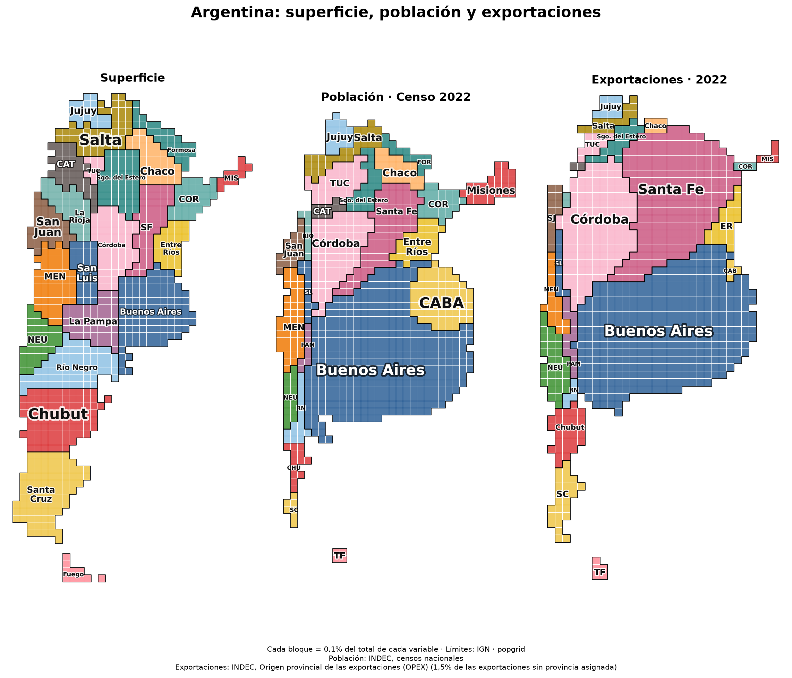
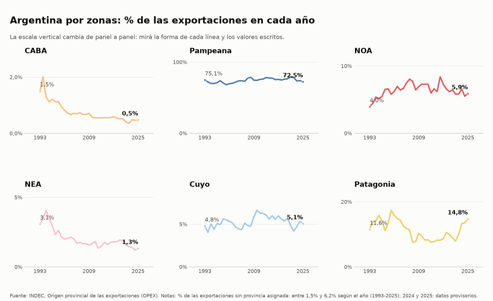
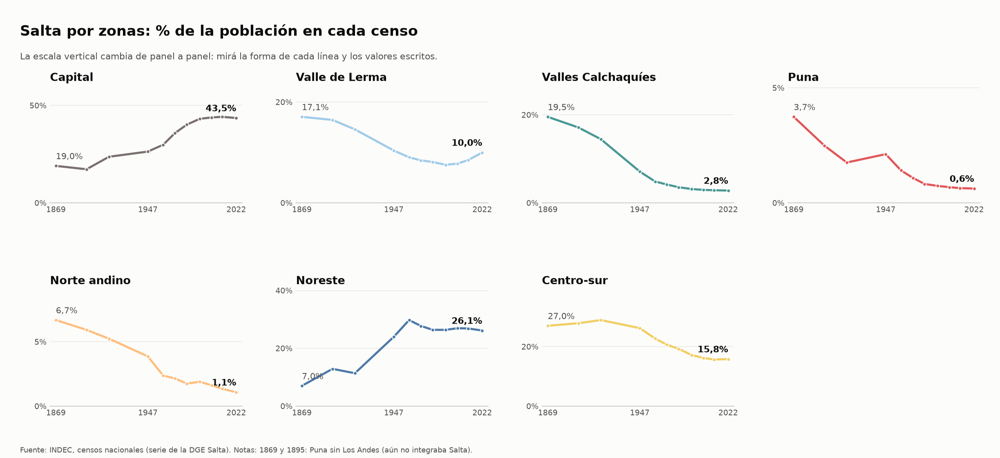
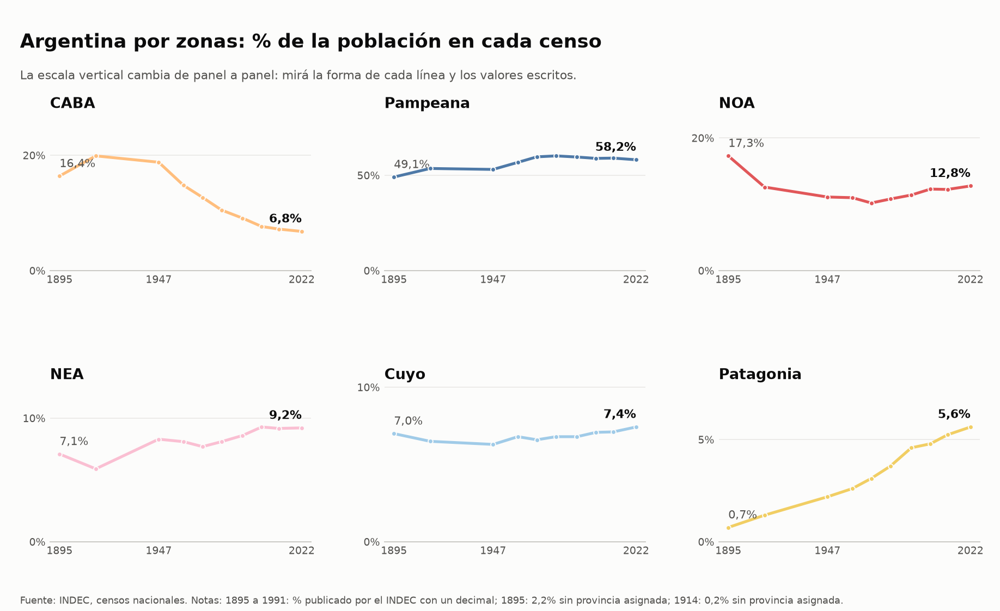

# popgrid-argentina

**Mapas de bloques de Argentina y de Salta: cómo cambió el peso de cada provincia, región y departamento a lo largo de los censos, y cómo se compara con las exportaciones. Salta por departamento desde 1869; provincias desde 1895; exportaciones desde 1993.**

Este proyecto usa [popgrid](https://github.com/databites-tech/popgrid) para dibujar *block cartograms*: mapas en los que **cada bloque representa la misma porción del total**. Con 1.000 bloques, cada uno equivale al 0,1% de la superficie, de la población o de la variable que se mapee. El mismo territorio, con los mismos colores, se dibuja de varias formas. Donde la tierra, la gente y la economía no coinciden aparece la historia.

Niveles de análisis:

| Nivel | Censos | Regiones | Pregunta |
|---|---|---|---|
| `provincias` | 10 censos, de 1895 a 2022 | 24 jurisdicciones | ¿Qué provincias ganaron o perdieron peso en la población del país? |
| `zonas:argentina` | 1895 a 2022 | 6 regiones: CABA, Pampeana, NOA, NEA, Cuyo, Patagonia | ¿Cómo se redistribuyó el país entre regiones? |
| `salta` (= `departamentos:66`) | los 11 censos nacionales, de 1869 a 2022 | 23 departamentos | ¿Cuánto se concentra Salta en Capital? ¿Qué pasó con el norte y con los Valles? |
| `zonas:salta` | 1869 a 2022 | 7 zonas: Capital, Valle de Lerma, Valles Calchaquíes, Puna, Norte andino, Noreste, Centro-sur | Lo mismo, con zonas como categoría analítica |
| `departamentos:<provincia>` | 2001, 2010 y 2022 | departamentos, partidos o comunas de cualquier provincia | Por ejemplo `departamentos:jujuy` o `departamentos:06` |

Las zonas son agrupaciones analíticas definidas en CSV editables ([`data/zonas/`](data/zonas/README.md)), no divisiones oficiales.

Además de la población, se puede mapear cualquier variable que se sume entre regiones. Hoy están:

| Variable | Años | Niveles | Fuente |
|---|---|---|---|
| `poblacion` | censos | todos | INDEC (y DGE Salta para la serie histórica) |
| `exportaciones` | 1993 a 2025, anual | `provincias`, `zonas:argentina` | INDEC, Origen provincial de las exportaciones |

<p align="center">
  
</p>

El mismo país visto de tres maneras en 2022. CABA tiene el 6,8% de la población y solo el 0,4% de las exportaciones de bienes. Santa Fe pasa del 7,7% de la población al 22,1% de las exportaciones, y Córdoba del 8,4% al 14,7%. La provincia de Buenos Aires pesa casi lo mismo en población y en exportaciones (38%). Salta tiene el 3,1% de la gente y el 1,5% de las exportaciones.

<p align="center">
  
</p>

Como el total cambia de un censo a otro, los mapas de distintos años muestran el **peso relativo** de cada región. Un departamento puede haber crecido en habitantes y, aun así, achicarse en el mapa si creció menos que el resto.

<p align="center">
  
</p>

En 1869, Capital tenía el 19% de la población salteña y los Valles Calchaquíes (Cachi, Molinos, San Carlos y Cafayate) el 19,5%. Hoy Capital tiene el 43,5% y los Valles el 2,8%. El norte cuenta otra historia: Orán y San Martín pasaron del 5% en 1869 al 21% en 1947 y al 27% en 1960, con el auge del azúcar y el petróleo, y desde entonces rondan el 24%. En los últimos censos, Cerrillos (del 2,4% en 2001 al 3,9% en 2022) y La Caldera, que más que duplicó sus habitantes, son las zonas que más crecen alrededor de la capital.

Hasta 1947, Orán y San Martín eran un solo departamento, y así se dibujan. Los Andes (la Puna) pasó a Salta recién en 1943, por eso no aparece en 1869 ni en 1895.

<p align="center">
  
</p>

La serie por zonas (`uv run python scripts/grafico_serie.py zonas:salta`). Cada panel tiene su propia escala, para que se vea la dinámica de las zonas chicas. Los valores quedan en `output/salta_zonas_serie.csv`.

<p align="center">
  
</p>

En 1895, CABA y Buenos Aires tenían el 39% del país. Hoy suman el 45%, pero repartido al revés: CABA pasó de casi el 20% (1914) al 7%, y la provincia de Buenos Aires, del 23% al 38%. El noroeste perdió peso entre 1895 y 1914 (Salta pasó del 2,9% al 1,8%) y lo fue recuperando de a poco: en 2022 Salta está en el 3,1%. Chaco, Formosa y la Patagonia casi no aparecen en 1895 (entre todas suman menos del 2%) y crecen a medida que se pueblan los ex territorios nacionales.

<p align="center">
  
</p>

Los mapas de 1895 a 1991 usan el porcentaje por provincia que publica el INDEC con un decimal (Censo 2010, Tomo 1, Cuadro 7). Con 1.000 bloques, una décima es un bloque, así que alcanza para el mapa. Desde 2001 se usan las cantidades exactas de personas.

---

## Instalación

Requiere Python 3.10 o superior. Se recomienda [uv](https://docs.astral.sh/uv/):

```bash
uv sync --extra dev        # crea .venv e instala todo
```

Con pip:

```bash
python3.12 -m venv .venv && source .venv/bin/activate
pip install -e ".[dev]"
```

---

## Uso

### 1. Descargar los límites (una sola vez)

```bash
uv run python scripts/descargar_limites.py
```

Baja la capa de departamentos del [IGN](https://www.ign.gob.ar/) (~140 MB, queda en `data/raw/` y no se sube a git) y genera tres archivos livianos en `data/limites/`:

- `provincias.geojson`: las 24 jurisdicciones, armadas uniendo departamentos. Se excluyen Antártida Argentina e Islas del Atlántico Sur.
- `salta_departamentos.geojson`: los 23 departamentos de Salta.
- `departamentos.geojson`: todos los departamentos del país, para trabajar otras provincias.

### 2. Datos censales (ya incluidos)

La población ya está cargada en:

- [`data/censos/provincias.csv`](data/censos/provincias.csv): 24 jurisdicciones; 2001, 2010 y 2022, en personas.
- [`data/censos/provincias_historico.csv`](data/censos/provincias_historico.csv): las mismas 24, de 1895 a 1991, en % del país con un decimal (columnas `pct_AAAA`), porque el INDEC no publica la serie en personas. Se regenera con `uv run python scripts/construir_provincias_historico.py --forzar`.
- [`data/censos/departamentos.csv`](data/censos/departamentos.csv): los 528 departamentos, partidos y comunas del país, con su código INDEC; 2001, 2010 y 2022. Salta es el subconjunto que empieza con `66`.
- [`data/censos/salta_historico.csv`](data/censos/salta_historico.csv): los 23 departamentos de Salta en los 11 censos nacionales, de 1869 a 2022. La fila `66126+66056` representa a Orán y San Martín cuando todavía eran un solo departamento (hasta 1947). Es la serie que usa el nivel `salta`, y se regenera con `uv run python scripts/construir_salta_historico.py --forzar`.

Las cifras salen de 48 cuadros oficiales del INDEC (dos por provincia). El detalle está en [`data/censos/FUENTES.md`](data/censos/FUENTES.md). Para regenerarlas desde el INDEC:

```bash
uv run python scripts/construir_censos.py --forzar
```

El script verifica que el valor de 2010 coincida entre las publicaciones de 2010 y 2022, y que en cada provincia los departamentos sumen el total provincial. Solo dos departamentos no tienen dato en algún censo, porque se crearon después: Lezama (Buenos Aires) y Tolhuin (Tierra del Fuego).

```python
from popgrid_ar.censos import cargar_departamentos

cargar_departamentos("66")  # Salta
cargar_departamentos()  # todo el país
```

| Censo | Total del país | Salta | Capital (Salta) |
|---|---|---|---|
| 2001 | 36.260.130 | 1.079.051 | 472.971 (43,8%) |
| 2010 | 40.117.096 | 1.214.441 | 536.113 (44,1%) |
| 2022 | 45.892.285 | 1.441.351 | 627.704 (43,5%) |

### 3. Generar los mapas

```bash
# Superficie + un mapa por censo, lado a lado
uv run python scripts/generar_mapas.py salta --modo comparar

# Un mapa por censo
uv run python scripts/generar_mapas.py provincias --modo poblacion

# Solo superficie (no necesita datos censales)
uv run python scripts/generar_mapas.py salta --modo superficie

# Tabla de participación (%) y variación entre censos, en CSV
uv run python scripts/generar_mapas.py salta --modo tabla

# Todo junto
uv run python scripts/generar_mapas.py salta --modo todo

# Zonas y departamentos de otras provincias
uv run python scripts/generar_mapas.py zonas:salta --modo todo
uv run python scripts/generar_mapas.py zonas:argentina --modo comparar
uv run python scripts/generar_mapas.py departamentos:jujuy --modo todo

# Exportaciones: mapas por año, serie y comparación con población
uv run python scripts/generar_mapas.py provincias --variable exportaciones --modo comparar
uv run python scripts/grafico_serie.py zonas:argentina --variable exportaciones --columnas 3
uv run python scripts/generar_mapas.py provincias --modo variables --anio 2022

# Serie (% por región y censo) en paneles chicos
uv run python scripts/grafico_serie.py zonas:salta
uv run python scripts/grafico_serie.py zonas:argentina --columnas 3
```

Opciones: `--variable poblacion|exportaciones`, `--censos 2010 2022` (o `--anios`) para elegir años, `--anio 2022` para el modo `variables`, `--n 2000` para usar más bloques (más detalle para departamentos chicos) y `--out carpeta/`. Todo se guarda en `output/`.

### Desde Python

```python
from popgrid_ar.mapas import comparar_censos, comparar_variables, mapa_variable
from popgrid_ar.censos import cargar_censo, tabla_participacion

mapa_variable("salta", 2022).savefig("salta_2022.png", dpi=170, bbox_inches="tight")
mapa_variable("provincias", 2025, variable="exportaciones")
comparar_censos("zonas:salta", [1869, 1947, 2022])
comparar_variables("zonas:argentina", 2022)
tabla_participacion(cargar_censo("salta"))
```

---

## Estructura

```
├── src/popgrid_ar/
│   ├── config.py      # rutas, códigos INDEC, exclusiones, etiquetas cortas
│   ├── niveles.py     # niveles de análisis: provincias, departamentos:<prov>, zonas:<...>
│   ├── variables.py   # variables mapeables: poblacion, exportaciones
│   ├── limites.py     # descarga del IGN, dissolve a provincias, simplificación
│   ├── censos.py      # lectura, validación y tabla de participación
│   └── mapas.py       # mapas de superficie, población y comparación con popgrid
├── scripts/
│   ├── descargar_limites.py
│   ├── construir_censos.py
│   ├── construir_salta_historico.py
│   ├── construir_provincias_historico.py
│   ├── construir_exportaciones.py
│   ├── grafico_serie.py
│   └── generar_mapas.py
├── data/
│   ├── censos/        # CSV de población por censo + FUENTES.md (versionado)
│   ├── economia/      # exportaciones por provincia + FUENTES.md (versionado)
│   ├── zonas/         # agrupaciones analíticas editables (salta.csv, argentina.csv)
│   ├── limites/       # GeoJSON simplificados (versionado, generado por script)
│   └── raw/           # descargas crudas del IGN y del INDEC (ignorado por git)
├── tests/
└── output/            # mapas generados (ignorado por git)
```

---

## Estado

Hecho:

- **Población:** provincias de 1895 a 2022, departamentos de Salta de 1869 a 2022 y departamentos de todas las provincias de 2001 a 2022. Todo desde cuadros oficiales, con controles de suma.
- **Zonas** como nivel de análisis: 7 zonas de Salta y 6 regiones del país, editables en `data/zonas/`.
- **Exportaciones** por provincia y región, de 1993 a 2025, y comparación con la población (`--modo variables`).
- **Visualizaciones:** mapas por censo o año, comparaciones en grilla, series en paneles chicos y tablas de participación.
- **Calidad:** tests (`uv run pytest`) y CI en GitHub Actions.

## Pendientes

En orden de prioridad sugerido:

- **PBI por provincia.** La fuente adecuada es el VAB provincial de CEPAL y CEP XXI ([publicación 47900](https://www.cepal.org/es/publicaciones/47900-desagregacion-provincial-valor-agregado-bruto-la-argentina-base-2004), anexo `Jurisdiccion_52sectores.xlsx`). Su sitio bloquea las descargas automatizadas, así que hay que bajar el archivo a mano y dejarlo en `data/raw/cepal/`. Con eso falta un `scripts/construir_pbi.py` y sumar `pbi` a `variables.py`. La grilla de PBI de Kummu et al. se probó y se descartó por un quiebre en la serie de Córdoba. Ver [`data/economia/FUENTES.md`](data/economia/FUENTES.md).
- **PBI por departamento.** Repartir el VAB provincial de CEPAL entre departamentos según la grilla de Kummu, usada solo para la distribución dentro de cada provincia. Conviene la grilla de 30", para que los departamentos chicos no queden mal medidos.
- **Zonas para otras provincias.** Por ejemplo `data/zonas/jujuy.csv` (`codigo,departamento,zona`). La agrupación la tiene que definir alguien que conozca la provincia.
- **Empleo registrado** por departamento (CEP XXI), como aproximación a la actividad económica local.
- **Municipios.** No son una unidad de los censos: habría que componerlos a partir de radios censales (cartografía y datos por radio del INDEC) y definir qué radios forman cada municipio.
- **Detalle menor:** la línea de fuente al pie de los mapas individuales dice "Source:" en inglés. Esa palabra la pone popgrid y no se puede cambiar desde sus opciones.

---

## Fuentes

- **Límites:** Instituto Geográfico Nacional (IGN), capa `departamento` del [servicio WFS](https://wms.ign.gob.ar/geoserver/ows). Incluye el código INDEC de cada departamento, que se usa para unir con los censos.
- **Población:** INDEC, Censos Nacionales de Población, Hogares y Viviendas 2001, 2010 y 2022. Para provincias de 1895 a 1991, INDEC, Censo 2010, Tomo 1, Cuadro 7 (distribución porcentual). Para la serie de Salta desde 1869, la [Dirección General de Estadísticas de Salta](https://estadisticas.salta.gov.ar/) (Anuario 2025, cuadro 2.1.1, sobre la base de los censos nacionales del INDEC). El detalle de cada cuadro está en [`data/censos/FUENTES.md`](data/censos/FUENTES.md).
- **Exportaciones:** INDEC, Origen provincial de las exportaciones (OPEX), 1993-2025. Ver [`data/economia/FUENTES.md`](data/economia/FUENTES.md).

## Créditos

Los mapas los dibuja [popgrid](https://github.com/databites-tech/popgrid), de [Josep Ferrer](https://databites.tech) ([databites.tech](https://databites.tech)), con licencia MIT. Este proyecto solo lo usa como dependencia y no modifica su código. Al publicar un mapa, conviene incluir una línea como *Hecho con popgrid de databites.tech*.

## Licencia

MIT. Ver [LICENSE](LICENSE).
